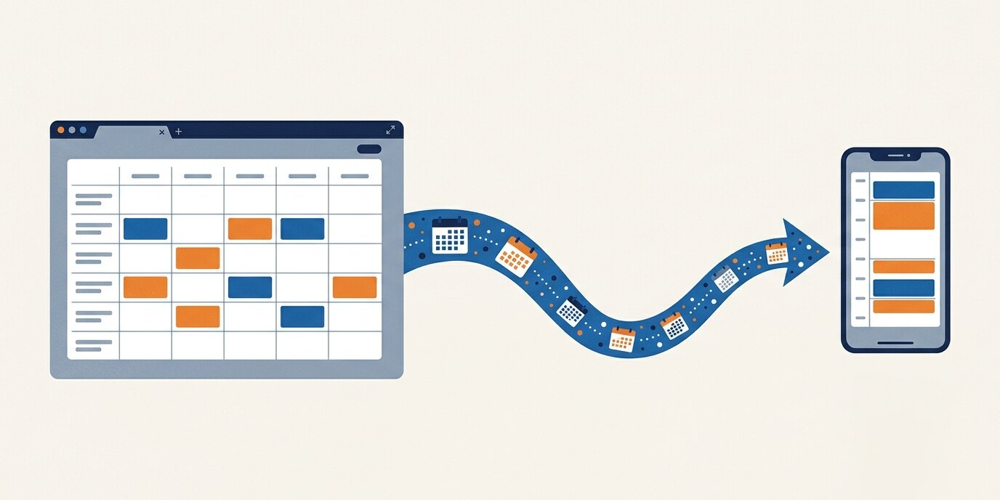
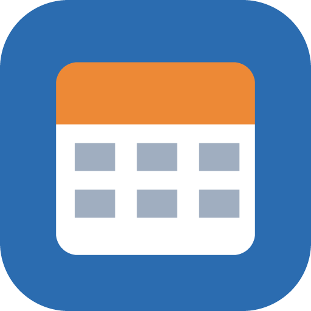
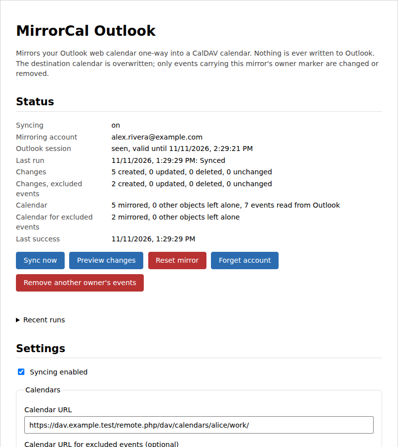
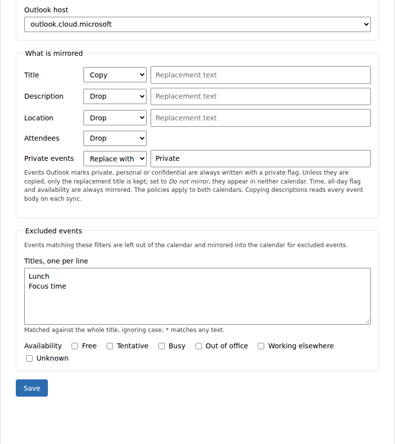

<p align="center">
  
</p>

<table>
<tr>
<td width="100">

</td>
<td>
<h1>MirrorCal Outlook</h1>
A browser extension that mirrors your Outlook web calendar, one way, into a CalDAV calendar.
</td>
</tr>
</table>

[](https://github.com/frederikb96/mirrorcal-outlook/actions/workflows/ci.yaml)
[](https://github.com/frederikb96/mirrorcal-outlook/releases)
[](https://opensource.org/licenses/MIT)

Your work meetings show up in the calendar app you already use, such as a Nextcloud calendar on your phone, without setting up an Outlook account on any device. The extension runs in the browser where you are signed in to Outlook on the web, reads the calendar from there and keeps a CalDAV calendar in step with it. Events you filter out can go into a second calendar instead of being dropped.

<p align="center">
  
</p>

## Why

Outlook on the web does not offer a CalDAV feed as far as I know, and the other routes (an app registration, a stored Outlook password) are not always available at work. This extension uses what you already have, a signed-in browser tab.

- **No Outlook account setup anywhere else.** It uses the access token the Outlook page itself sends, so there is no app registration, no admin consent and no Outlook password to store.
- **Outlook is only read.** The extension has no code path that sends anything but the calendar-view read to Outlook, and a test keeps it that way.
- **It only touches what it wrote.** Every mirrored event carries an owner id. Events without it, or with another one, are reported and never changed or deleted.
- **It stops instead of guessing.** A failed or partial read writes nothing, and a plan that would remove most of a calendar waits for your confirmation.
- **Filtered events have somewhere to go.** Titles and availability can route events into a second calendar, so lunch blocks or free time stay out of your main calendar and are still on hand in the other one.

## How it fits together

```
Outlook on the web  →  browser extension  →  CalDAV calendar (and one for excluded events)
```

Everything runs inside the browser; there is no server of ours in between. The Outlook token stays in memory and is never sent anywhere but Outlook. The CalDAV app password is stored in the extension's storage and is only sent to the calendar server it was entered for. [docs/how-it-works.md](docs/how-it-works.md) walks through a sync step by step.

## What you need

- A Chromium-based browser. The browser test runs Chromium, and the extension is used in Edge.
- Outlook on the web, signed in, in a tab of that browser.
- A CalDAV calendar that nothing else writes to, and an app password for it. The URL is the calendar's own collection, for example `https://host/remote.php/dav/calendars/<user>/<calendar>/`.

## Install

The extension is not in a store. Load it as an unpacked extension.

- Download `mirrorcal-outlook.zip` from the [latest release](https://github.com/frederikb96/mirrorcal-outlook/releases/latest) and unzip it into a folder you keep. To build it instead: `bun install && bun run build`, the result is `dist/`.
- Open `chrome://extensions` (Edge: `edge://extensions`) and switch on developer mode.
- Choose **Load unpacked** and select the folder that contains `manifest.json`.
- Open Outlook on the web and sign in. The extension can only sync while it has seen a valid token from that page.
- Open the extension's options page, enter the calendar URL, user name and app password, and press **Save**. It checks the calendar, shows its name and starts a first sync.

The manifest carries a fixed public key, so the extension id is the same whichever folder it is loaded from and settings survive a move.

To update, replace the files in the same folder and press **Reload** on the extension's card. Settings, the saved password and the account binding stay. Loading the new files from a different folder adds a second extension next to the old one; remove the old one first, because two copies with the same owner id would both mirror into the same calendar.

## Configuration

Everything is set on the options page. [docs/settings.md](docs/settings.md) describes every field, the status panel, the buttons and the toolbar badge.

<p align="center">
  
</p>

## Docs

- [How it works](docs/how-it-works.md): token capture, one sync run, the plan, account binding.
- [Settings](docs/settings.md): the options page, field by field.
- [Safety](docs/safety.md): what is guaranteed about Outlook and the destination calendar, and what is stored where.
- [Development](docs/development.md): commands, tests, screenshots and the release process.

## Known limitations

- Sync only runs while the browser is running and Outlook on the web has been open and signed in long enough for the extension to see a token.
- The extension depends on Outlook web's internal calendar endpoint and on the token the page sends. Microsoft can change either without notice.
- One direction only. Changes made in the destination calendar are never read back, and the next sync overwrites them.
- The mirror follows one Outlook account. A second account open in the same browser is ignored once the first has synced.

## What leaves the machine

The calendar server you configure receives the mirrored events, with the fields your policies allow, and the user name and app password. Outlook receives only the calendar-view read with the token its own page sent. Nothing goes to any other host.

## Not affiliated

This project is not affiliated with, endorsed or sponsored by Microsoft or Nextcloud. Outlook, Microsoft and Nextcloud are trademarks of their owners.

## License

[MIT](LICENSE)
